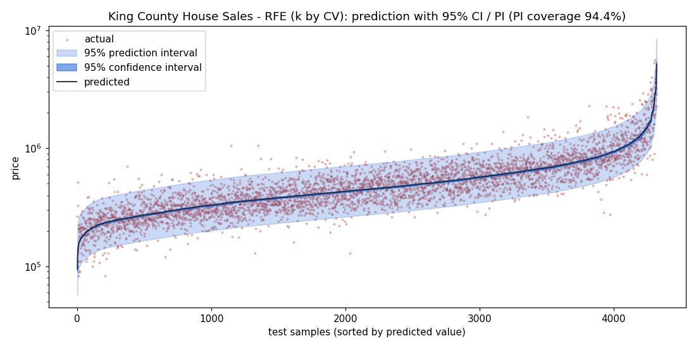
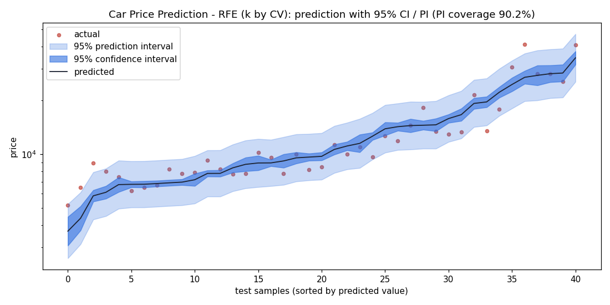

# HW2 · Multiple Linear Regression（CRISP-DM）

以兩個 Kaggle 資料集（特徵數皆在 14–39 之間）做多元線性迴歸，完成**特徵選擇**、**模型評估**，並畫出含 **95% 信賴區間（CI）與 95% 預測區間（PI）** 的預測圖。

| Problem | Kaggle 資料集 | 筆數 | 特徵數 | Target |
|---|---|---|---|---|
| 1. 房價預測 | [House Sales in King County, USA](https://www.kaggle.com/datasets/harlfoxem/housesalesprediction)（[CSV 副本](https://raw.githubusercontent.com/Shreyas3108/house-price-prediction/master/kc_house_data.csv)） | 21,613 | 19（不含 `id`、`price`） | `price` |
| 2. 車價預測 | [Car Price Prediction](https://www.kaggle.com/datasets/hellbuoy/car-price-prediction)（[CSV 副本](https://raw.githubusercontent.com/amankharwal/Website-data/master/CarPrice.csv)） | 205 | 24（不含 `car_ID`、`price`） | `price` |

> Kaggle 需要登入才能下載，網頁沒辦法直接讀 Kaggle，所以網頁從 GitHub 上的 CSV 副本載入（內容與 Kaggle 版本相同），`data/` 也放了一份本機副本。

## 線上 Demo（GitHub Pages）

👉 https://juipiao-chen.github.io/AIoT-HW2-Multiple-Linear-Regression/

`index.html` 是純前端網頁，所有計算都在瀏覽器裡完成：

- **下拉選單切換兩種 problem**（加分 1）
- **可輸入任意 Dataset URL**（加分 2，例如 [50_Startups.csv](https://raw.githubusercontent.com/Avik-Jain/100-Days-Of-ML-Code/master/datasets/50_Startups.csv)），也可以上傳本機 CSV；可自選 Target、Features、哪些特徵取 log
- 四種特徵選擇方法：Backward Elimination（p-value）、Forward Stepwise（AIC）、Top-k 相關係數、All-in，並列出比較表
- **預測圖含 95% CI 與 95% PI**，並計算 PI 在 test set 的實際覆蓋率
- 係數表（SE、t、p-value、VIF）、Actual vs Predicted、殘差圖、特徵數 vs 誤差曲線
- Deployment：輸入特徵值 → 預測值 + 95% CI + 95% PI

## CRISP-DM

### 1. Business Understanding

- **King County 房價**：房仲 / 買方想依房屋條件估計合理成交價。只給一個數字不夠，還要給**價格可能範圍**（預測區間）才能拿來議價。
- **車價**：一家想進入美國市場的車廠想知道哪些車輛規格真正影響售價，以設計車款與訂價。

### 2. Data Understanding

- 兩個資料集都**沒有缺值**。
- 房價：`price` 嚴重右偏（skew ≈ 4），`sqft_*` 面積類欄位也是右偏。`sqft_living = sqft_above + sqft_basement` **完全成立**（完全共線）。
- 車價：24 個特徵中有 10 個類別欄位（`fueltype`、`carbody`、`enginetype`、`cylindernumber`…），部分類別很稀少（例如 `enginelocation = rear` 只有 3 台）。`CarName` 有 147 種值、只有 205 筆，是近乎唯一的識別碼。
- 相關係數圖：`results/house_corr.png`、`results/car_corr.png`。房價與 `sqft_living`、`grade`、`sqft_above` 最相關；車價與 `enginesize`、`curbweight`、`horsepower` 最相關。

### 3. Data Preparation

| 步驟 | 房價 | 車價 |
|---|---|---|
| 移除識別碼 / 不適合的欄位 | `id`、`date`、`zipcode`（郵遞區號是代碼不是數量；位置由 `lat`/`long` 表示） | `car_ID`、`CarName` |
| 類別欄位 | 無 | One-Hot（drop first，避免 dummy variable trap）→ 40 欄 |
| Target 轉換 | `log(price)` | `log(price)` |
| 特徵轉換 | `sqft_living`、`sqft_lot`、`sqft_above`、`sqft_living15`、`sqft_lot15` 取 `log(1+x)` | — |
| 完全共線 / 常數欄位 | 在 training set 上檢查後自動移除 | 移除 `cylindernumber_three/two`、`fuelsystem_idi` |
| 切分 | 80/20，`random_state=42` | 同左 |

**為什麼房價要做 log-log？** 我先試了三種做法（test R²，原始美元單位）：

| 做法 | Test R² |
|---|---|
| 原始 `price` ~ 原始特徵 | 0.696 |
| `log(price)` ~ 原始特徵 | 0.492 ← 大坪數豪宅的預測值 `exp()` 後爆掉（預測 1,400 萬、實際 228 萬） |
| `log(price)` ~ `log(面積)` + 其他特徵（採用） | **0.731** |

log-log 模型的殘差變得比較均勻，而且預測區間在原始單位下會隨價格放大，比較符合現實（貴的房子價差本來就大）。

### 4. Modeling（特徵選擇）

模型都是 OLS 多元線性迴歸。**所有特徵選擇都只用 training set**，避免資料洩漏。`hw2_analysis.py` 比較六種方法：

1. All-in（全部特徵）
2. Backward Elimination（p-value > 0.05 就移除）
3. Forward Stepwise（每步加入讓 AIC 下降最多的特徵）
4. SelectKBest（F-test 排序，k 由 5-fold CV 決定）
5. RFE（Recursive Feature Elimination，k 由 5-fold CV 決定）
6. LassoCV（保留係數非零的特徵，再用 OLS 重新估計）

**最終模型**：在 training set 上 5-fold CV RMSE 最低的方法（相同時選特徵較少的）。

### 5. Evaluation

**Problem 1：King County 房價**（train 17,290 / test 4,323）

| Method | # Features | CV RMSE (train) | Train Adj R² | Test R² | Test MAE | Test RMSE |
|---|---|---|---|---|---|---|
| All-in | 17 | 180,677 | 0.7698 | 0.7272 | 112,711 | 203,068 |
| Backward Elimination | 16 | 180,553 | 0.7698 | 0.7277 | 112,691 | 202,893 |
| Forward Stepwise (AIC) | 16 | 180,553 | 0.7698 | 0.7277 | 112,691 | 202,893 |
| SelectKBest (k by CV) | 17 | 180,677 | 0.7698 | 0.7272 | 112,711 | 203,068 |
| **RFE (k by CV)** ✅ | **15** | **180,441** | 0.7697 | **0.7279** | 112,729 | **202,801** |
| LassoCV | 17 | 180,677 | 0.7698 | 0.7272 | 112,711 | 203,068 |

- 最終模型 RFE 保留 15 個特徵（拿掉 `long`、`sqft_lot`），**95% PI 在 test set 的覆蓋率 = 94.4%**，非常接近理論值 95%。
- 各方法差距很小：樣本有 1.7 萬筆、特徵只有 17 個，每個特徵都「有一點用」，所以特徵選擇的價值在於**簡化模型**而不是提升準確度。
- 最重要的特徵（Forward Stepwise 的加入順序）：`grade` → `lat` → `sqft_living` → `yr_built` → `view` → `bathrooms`。
- `lat` 係數 1.34：緯度每往北 0.1 度（約 11 公里），房價約 × e^0.134 ≈ +14%（King County 北半部、靠近 Seattle 的區域較貴）。`waterfront` 係數 0.41：臨水房價約 × 1.51。
- VIF：`sqft_living`（34）與 `sqft_above`（29）高度共線，係數個別解釋要小心，但不影響預測。
- 迴歸假設：Durbin-Watson = 2.00（殘差無自相關 ✅）；Jarque-Bera 與 Breusch-Pagan p ≈ 0（大樣本下殘差有厚尾、輕微異質變異 ⚠️，Q-Q 圖兩端偏離）。



> 房價圖上的 CI（深色）幾乎看不到：因為樣本數很大，「平均價格」估得很準；但 PI（淺色）很寬，代表**同樣條件的單一房子**價格差異仍然很大。這就是 CI 與 PI 的差別。

**Problem 2：車價**（train 164 / test 41）

| Method | # Features | CV RMSE (train) | Train Adj R² | Test R² | Test MAE | Test RMSE |
|---|---|---|---|---|---|---|
| All-in | 40 | 5,056 | 0.9257 | 0.8962 | 1,912 | 2,863 |
| Backward Elimination | 19 | 4,438 | 0.9286 | 0.8843 | 1,992 | 3,022 |
| Forward Stepwise (AIC) | 24 | 3,888 | 0.9276 | 0.9045 | 1,800 | 2,745 |
| SelectKBest (k by CV) | 20 | 2,740 | 0.9049 | 0.8808 | 1,864 | 3,068 |
| **RFE (k by CV)** ✅ | **10** | **2,343** | 0.9098 | 0.8632 | 2,106 | 3,286 |
| LassoCV | 26 | 3,347 | 0.9272 | 0.9048 | 1,804 | 2,742 |

- 最終模型 RFE 只用 **10 個特徵**：`curbweight`、`horsepower`、`carwidth`、`enginelocation_rear`、`citympg`、`compressionratio`、`fuelsystem_mpfi`、`enginetype_ohc`、`cylindernumber_four`、`carbody_wagon`，**95% PI 覆蓋率 = 90.2%**。
- 這裡特徵選擇**很重要**：只有 164 筆訓練資料卻有 40 個欄位，All-in 的 CV RMSE（5,056）是 RFE（2,343）的兩倍多——稀有類別在某些 fold 沒出現，導致係數不穩定、預測爆掉。
- Test set 只有 41 筆，test R² 的差距（0.86–0.90）大多在雜訊範圍內，所以用 CV RMSE 選模型比用 test 分數可靠。
- 係數解讀：引擎後置（`enginelocation_rear`）價格約 × e^0.67 ≈ 1.95 倍；車重每多 100 磅約 +4.6%。
- 迴歸假設：Durbin-Watson = 1.80 ✅；Jarque-Bera p = 0.08、Breusch-Pagan p = 0.054（在 0.05 水準下沒有違反常態性與同質變異 ✅）；VIF 全部 < 10 ✅。



其他圖：`results/*_diagnostics.png`（Actual vs Predicted、殘差圖、Q-Q 圖）、`results/*_fs_curve.png`（特徵數 vs CV RMSE）。完整數字在 `results/summary.json`。

### 6. Deployment

- GitHub Pages 網頁（`index.html`）：選問題或輸入任意 CSV URL → 自動完成 Data Understanding、Preparation、Modeling、Evaluation → 在 Deployment 區輸入特徵值，得到**預測值 + 95% CI + 95% PI**。
- 例如房價模型、各特徵取中位數時：預測約 39.4 萬美元，95% PI 約 24.0 萬～64.7 萬美元。

> 網頁的 train/test 切分是在 JS 裡用同一個 seed 做的，跟 sklearn 的切法不同；網頁提供 4 種特徵選擇方法（RFE、Lasso 只在 Python 版），所以網頁上的數字會和上表有些差異。

## 本機執行

```bash
pip install -r requirements.txt
python hw2_analysis.py                    # 兩個 problem，輸出到 results/
python hw2_analysis.py --problem car      # 只跑其中一個
python hw2_analysis.py --url <CSV_URL> --target <column> --drop id,name --log   # 任意資料集

python -m http.server 8000                # 打開 http://localhost:8000 預覽網頁
```

## 部署到 GitHub Pages

1. 把這個資料夾 push 到 GitHub repo 的 `main` branch。
2. 打開 repo 的 **Settings → Pages → Build and deployment → Source**，選 **GitHub Actions**，`.github/workflows/pages.yml` 會自動部署。

## AI 協助說明

### GPT 輔助內容

- **選資料集**：老師提供的 ChatGPT 對話（「list kaggle multiple linear regression problems, choose features > 13, < 40」）建議了 Predict the Flood、Istanbul Apartment Prices、House Prices 等題目，以及「CRISP-DM + Feature Selection（SelectKBest、RFE、Sequential Feature Selection、Lasso）+ 五大迴歸假設檢驗」的作業架構。本作業的特徵選擇方法比較與假設檢驗即依此架構設計。
- **程式與報告**：`hw2_analysis.py`、`index.html` 與本 README 由 AI（Claude Code）協助撰寫，包含 log-log 轉換的比較、共線性處理、CI/PI 計算與網頁。
- 本作業未另外附上對話紀錄 PDF，也未使用 NotebookLM 撰寫摘要（兩者在繳交內容中為 optional）。

## 檔案

```
index.html                  GitHub Pages 網頁（MLR web app）
hw2_analysis.py             Python CRISP-DM 分析（6 種特徵選擇方法、CI/PI、假設檢驗）
data/                       兩個資料集的本機副本
results/                    圖表與 summary.json
.github/workflows/pages.yml GitHub Pages 自動部署
```
